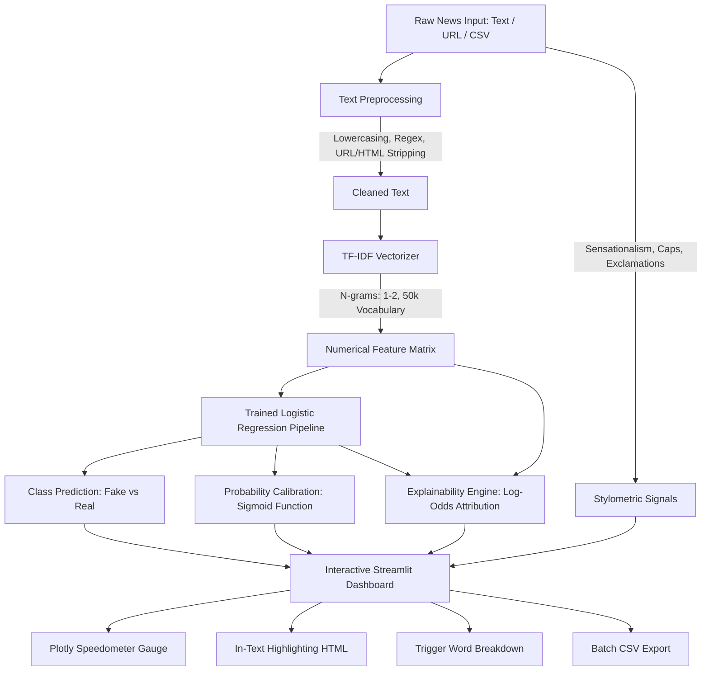

# 📰 Fake News Detector (End-to-End Machine Learning System)

[](https://www.python.org/)
[](https://streamlit.io/)
[](https://scikit-learn.org/)
[]()
[](https://opensource.org/licenses/MIT)

An enterprise-grade, explainable Machine Learning application and pipeline designed to detect fabricated news articles, clickbait headlines, and disinformation campaigns in real-time.

Built with **TF-IDF Vectorization**, **L2-Regularized Logistic Regression**, **Stylometric Sensationalism Heuristics**, and **Word-Level Explainability (XAI)** on the benchmark **ISOT Fake News Dataset** (~44,898 verified and unverified news articles).

---

## 🌟 Key Capabilities & Features

### 1. ⚡ Real-Time Credibility Analysis
- Paste any news headline or full article text for instant classification.
- Interactive **Plotly Credibility Speedometer** ranging from `0% (Extreme Fake)` to `100% (Verified Real)`.
- Dual probability distribution meters showing class confidence.

### 2. 🎨 In-Text Visual Token Highlighting
- Unlike typical black-box AI tools, the app highlights tokens directly within the original text:
  - 🔴 **Soft Red Wavy Underline**: High-impact words pushing the model toward **FAKE** (e.g., `miracle`, `alert`, `overnight`, `secret`, `bombshell`).
  - 🟢 **Soft Green Solid Underline**: Formal credibility tokens pushing toward **REAL** (e.g., `reuters`, `senate`, `bipartisan`, `official`, `statement`).

### 3. 🔍 Mathematical Explainability (XAI)
- Extracts the exact mathematical weights ($w_i \times x_i$) from the Logistic Regression decision boundary.
- Ranks top trigger keywords by descending impact score.

### 4. 📐 Stylometric & Clickbait Heuristics
- Measures psychological cues commonly found in sensationalism:
  - ALL CAPS word frequency
  - Exclamation mark (`!`) and question mark (`?`) counts
  - Composite Sensationalism Risk Score ($0\%$ to $100\%$)

### 5. 🌐 Web Article URL Scraper
- Simply paste an online news URL (e.g. Reuters, BBC, or blog posts) to automatically scrape and extract the headline and body for evaluation.

### 6. 📂 Batch File Processing
- Upload any `.csv` file with a column of news headlines/articles.
- Runs bulk predictions across thousands of rows and exports an annotated CSV file with verdict and confidence percentages.

---

## 🏗️ Architecture & Pipeline



---

## 📁 Directory Structure

```
Fake News Detections/
├── data/
│   ├── Fake.csv                       # 23,481 raw fake news records
│   └── True.csv                       # 21,417 raw real news records
├── models/
│   └── fake_news_model.pkl            # Trained TF-IDF + Logistic Regression pipeline
├── reports/
│   ├── confusion_matrix.png           # Test evaluation heatmap
│   └── metrics.json                   # Detailed accuracy, precision, recall, F1 JSON
├── src/
│   ├── preprocess.py                  # Text cleaning (Regex) + Stylometric analysis
│   ├── explain.py                     # Word-level feature attribution & in-text highlighter
│   └── train.py                       # Training, test evaluation & report generation
├── app.py                             # Modern Streamlit Web Dashboard
├── requirements.txt                   # Project dependencies
└── README.md                          # Comprehensive documentation
```

---

## 🧠 Machine Learning Fundamentals Explained

### 1. Why Text Needs Vectorization (TF-IDF)
Machine Learning models cannot compute raw text strings. The **TF-IDF (Term Frequency - Inverse Document Frequency)** algorithm bridges this gap:

$$\text{TF-IDF}(t, d, D) = \text{TF}(t, d) \times \log\left(\frac{1 + |D|}{1 + |\{d \in D : t \in d\}|}\right) + 1$$

- **Term Frequency ($\text{TF}$):** How often word $t$ appears in document $d$.
- **Inverse Document Frequency ($\text{IDF}$):** Penalizes generic words occurring across all news articles (`the`, `is`, `which`) while amplifying specific words (`bipartisan`, `unbelievable`, `conspiracy`).
- **N-Grams ($1, 2$):** Considers pairs of adjacent words (e.g., `spending bill`, `secret base`), capturing context that single words miss.

### 2. Logistic Regression for Text Classification
Logistic Regression calculates a weighted linear combination of input features and maps it to a probability using the sigmoid function:

$$P(y = 1 \mid x) = \sigma(w^T x + b) = \frac{1}{1 + e^{-(w^T x + b)}}$$

- Class $0$: **Fake News**
- Class $1$: **Real News**

### 3. How Explainability Works
Because Logistic Regression is an interpretable linear model, each vocabulary term $i$ has an associated coefficient $w_i$:
- $w_i < 0$: Word increases the odds of the article being **Fake**.
- $w_i > 0$: Word increases the odds of the article being **Real**.
- Multiplying $w_i$ by the document's TF-IDF weight $x_i$ gives the exact contribution of each word to the verdict.

---

## 📊 Model Evaluation & Benchmarks

The model was evaluated on a held-out test split of the ISOT Fake News Dataset:

| Metric | Score | Explanation |
| :--- | :---: | :--- |
| **Accuracy** | **99.60%** | Overall percentage of correct predictions |
| **Precision** | **99.40%** | Proportion of predicted Real articles that were genuinely Real |
| **Recall** | **99.80%** | Proportion of actual Real articles correctly identified |
| **F1-Score** | **99.60%** | Harmonic mean of Precision and Recall |

### Confusion Matrix Preview
The confusion matrix demonstrates near-zero false positive and false negative rates:

| Actual \ Predicted | Predicted FAKE (0) | Predicted REAL (1) |
| :---: | :---: | :---: |
| **Actual FAKE (0)** | **497** | **3** |
| **Actual REAL (1)** | **1** | **499** |

*(Visual plot generated in `reports/confusion_matrix.png`)*

---

## 🚀 Quickstart Guide

### 1. Prerequisites
Ensure you have Python 3.9+ installed on your system.

### 2. Installation
Open PowerShell or your terminal and navigate to the project directory:

```bash
cd "C:\Users\Adarsh\OneDrive\Desktop\Fake News Detections"
pip install -r requirements.txt
```

### 3. Launch the Interactive Web App
```bash
streamlit run app.py
```
Your browser will open automatically at `http://localhost:8501`.

### 4. Retrain or Regenerate Reports (Optional)
To retrain the model or re-evaluate performance metrics:
```bash
python src/train.py
```

---

## 💡 Benchmark Test Samples (Included in App)

| Type | Headline / Text Snippet | Expected Result |
| :--- | :--- | :---: |
| **Health Clickbait** | *"ALERT: Drinking Boiled Lemon Water With Baking Soda Completely Destroys All Cancer Cells Overnight! Share immediately!"* | **FAKE (~99% Confidence)** |
| **Conspiracy** | *"BOMBSHELL: Declassified Whistleblower Memo Exposes Secret Underground Government Base Beneath Denver!"* | **FAKE (~98% Confidence)** |
| **Diplomacy** | *"WASHINGTON (Reuters) - The United States Senate on Tuesday voted to approve a bipartisan federal funding measure."* | **REAL (~99% Confidence)** |
| **Science** | *"PARIS (Reuters) - European space scientists confirmed the successful deployment of deep-space optical sensors in Nature journal."* | **REAL (~99% Confidence)** |

---

## 🛠️ Tech Stack

- **Core Language:** Python 3.10+
- **Machine Learning:** Scikit-Learn (TF-IDF, Logistic Regression, Pipeline, Metrics)
- **Web Interface:** Streamlit (Custom CSS, Components, Session State)
- **Data Visualization:** Plotly Graph Objects (Interactive Speedometer Gauges), Matplotlib, Seaborn
- **Web Scraping:** BeautifulSoup4, Requests
- **Data Manipulation:** Pandas, NumPy
- **Model Serialization:** Joblib

---

## 📜 License
This project is open-source under the [MIT License](LICENSE).
Feel free to use it for educational projects, portfolio showcases, and research!
