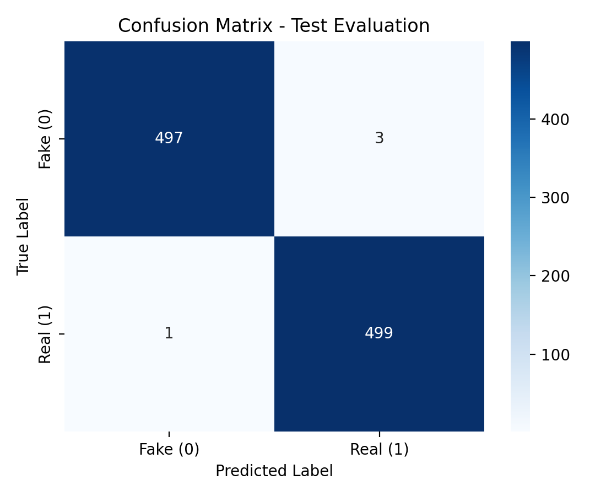

# Fake News Detection using Machine Learning

A TF-IDF + Logistic Regression classifier that labels news articles as **Real** or **Fake**. A Streamlit app shows the prediction, the words that pushed it in each direction, and simple writing-style signals.

## Features

- Text cleaning and writing-style signals: ALL-CAPS words, exclamation and question marks, and a heuristic sensationalism score (`src/preprocess.py`)
- TF-IDF (1-2 word n-grams, 50,000 features) + Logistic Regression (`src/train.py`)
- Word-level explanations: each word's impact is its TF-IDF weight times its model coefficient (`src/explain.py`)
- Streamlit app with three input modes: paste text, load an article from a URL, or upload a CSV for batch prediction (`app.py`)
- Robustness check for dataset leakage (`src/leakage_check.py`)
- Unit tests (`tests/`) and a GitHub Actions workflow

## Project Structure

```
├── app.py                   # Streamlit app
├── src/
│   ├── preprocess.py        # text cleaning and style signals
│   ├── train.py             # training and evaluation
│   ├── explain.py           # prediction and word-level explanations
│   └── leakage_check.py     # robustness check
├── models/fake_news_model.pkl
├── data/
│   ├── sample_news.csv      # tiny sample for quick tests
│   └── README.md            # dataset download instructions
├── reports/                 # metrics.json, confusion_matrix.png
├── tests/                   # test_pipeline.py, test_extra.py
├── 01_NLP_Basics.ipynb      # notebook: NLP basics
├── requirements.txt
├── run.bat                  # starts the app on Windows
├── .github/workflows/tests.yml   # runs the tests on every push
├── .gitattributes
└── LICENSE
```

## Installation

Requires Python 3.11 or newer. The saved model was created with scikit-learn 1.8.x; if you see a version warning when loading it, run `python src/train.py` to create a model with your own version.

```bash
git clone https://github.com/Adarsh8158/Fake-News-Detection--Using-Machine-Learning-.git
cd Fake-News-Detection--Using-Machine-Learning-

python -m venv venv
venv\Scripts\activate          # Windows
# source venv/bin/activate     # macOS / Linux

pip install -r requirements.txt
```

## Dataset

The model uses the **ISOT Fake News dataset**: `True.csv` (real articles from Reuters) and `Fake.csv` (articles from sites flagged as unreliable). The two files are over 100 MB together, so they are not stored in this repository.

1. Download the dataset from [Kaggle: Fake and Real News Dataset](https://www.kaggle.com/datasets/clmentbisaillon/fake-and-real-news-dataset).
2. Put `True.csv` and `Fake.csv` in the `data/` folder.

Please refer to the Kaggle page for the dataset's source and terms of use. `data/sample_news.csv` is a small sample for quick testing and batch prediction in the app; the app and the tests work without the large files, and only `train.py` and `leakage_check.py` need them.

## Usage

Run the app (a trained model is already in `models/`):

```bash
streamlit run app.py
```

On Windows you can also double-click `run.bat`.

Retrain and evaluate (needs `True.csv` and `Fake.csv` in `data/`):

```bash
python src/train.py
```

This trains a new model on a train split and evaluates it on the held-out test split. It uses the first 2,000 rows of each file (4,000 articles, minus empty/duplicate texts) and a 75/25 stratified split, and overwrites `models/fake_news_model.pkl`, `reports/metrics.json` and `reports/confusion_matrix.png`. Use `--sample-size` to change the amount of data, or `--use-saved-model` to evaluate the existing model without retraining.

Run the tests (they do not need the large CSV files):

```bash
python -m unittest discover -s tests
```

The tests cover text cleaning, edge cases (empty, non-English and very long input), the Real/Fake label mapping, the leakage-check helpers, and a small training smoke test on `data/sample_news.csv`. GitHub Actions runs them on every push.

## How It Works

1. **Cleaning:** lowercase, remove URLs, HTML tags, punctuation and digits.
2. **TF-IDF:** each article becomes a weighted word vector. With smooth idf (the scikit-learn default), the weight of term *t* in document *d* is

   `tf-idf(t, d) = tf(t, d) × ( ln((1 + N) / (1 + df(t))) + 1 )`

   where *N* is the number of documents and *df(t)* is how many contain *t*.
3. **Classifier:** Logistic Regression outputs the probability that the article is Real or Fake (labels: Real = 1, Fake = 0).
4. **Explanation:** for the words in the article, impact = TF-IDF weight × coefficient. Negative impact points to Fake, positive to Real, and the top words are highlighted in the app.

## Results



Held-out evaluation on 998 articles (500 Fake, 498 Real), from `reports/metrics.json` after running `python src/train.py`:

| Metric (Real = positive class) | Value |
|---|---|
| Accuracy | 98.9% |
| Precision | 98.6% |
| Recall | 99.2% |
| F1-score | 98.9% |

The model was trained fresh on the train split, so the test articles were not seen in training. Treat these numbers with the caution described below.

## Known Limitations

- **The app shows a statistical guess, not a verdict.** Its labels mean "looks like ISOT's real articles" or "looks like ISOT's fake articles", and the app says so.
- **ISOT has well-known shortcuts.** Most real articles start with a source tag like `CITY (Reuters) -`, and the dataset contains duplicate articles. A model can score very high by learning these instead of anything about truthfulness. A high score on ISOT shows the model separates ISOT's two sources well, not that it detects misinformation in general.
- **The model reads vocabulary and style, not facts.** It does not check claims against any source, so it is not a fact-checker.
- **It may not generalise** to other news sources, topics or time periods without retraining and testing on data from those sources.
- **The training sample is the first rows of each file,** not a random sample, so it may not represent the whole dataset.

## Robustness Check

`src/leakage_check.py` measures how much the score depends on those artifacts. It uses the same cleaning, model settings, sample and split as `train.py`, and trains the model three times:

| Variant | What is removed from the text |
|---|---|
| Baseline | nothing |
| Reuters tag removed | the `(Reuters)` dateline and the word "reuters" |
| Source tags removed | the above, plus "featured image", "getty images", `pic.twitter.com` links and similar publisher artifacts |

```bash
python src/leakage_check.py                  # same 4,000-article sample as train.py
python src/leakage_check.py --sample-size 0  # all articles
```

It prints accuracy, Fake-class precision/recall/F1, the confusion matrix and the top words per class for each variant, and saves them to `reports/leakage_check_results.json`. To test on a different dataset:

```bash
python src/leakage_check.py --external data/other.csv --text-col text --label-col label --real-value 1
```

If accuracy barely changes after cleaning, the model is not leaning on those tags. If it drops a lot, the baseline score was inflated.

### Results of the check

Run on the default 4,000-article sample (3,989 after removing duplicates; 2,991 train / 998 test):

| Variant | Accuracy | Fake precision | Fake recall | Fake F1 |
|---|---|---|---|---|
| Baseline | 98.9% | 99.2% | 98.6% | 98.9% |
| Reuters tag removed | 98.8% | 99.4% | 98.2% | 98.8% |
| Reuters + other source tags removed | 98.7% | 99.2% | 98.2% | 98.7% |

Removing the source tags lowers accuracy by only 0.2 percentage points, so the score does not depend on the `(Reuters)` tag. The model still leans on other source and style cues: for example "said", weekday names and "washington" point to Real, while "image", "video" and "gop" point to Fake. So this shows the model separates ISOT's two sources well, not that it can judge whether a claim is true. It has not been tested on a different dataset.

## Tech Stack

Python, scikit-learn, pandas, NumPy, Streamlit, Plotly, Matplotlib, Seaborn, BeautifulSoup

## License

MIT, see [LICENSE](LICENSE).